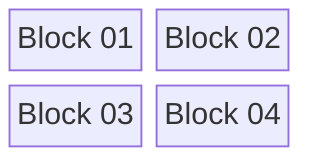
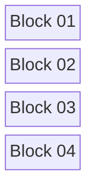
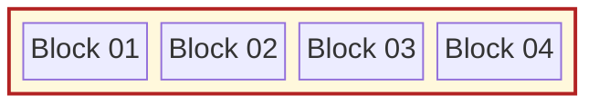
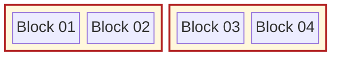
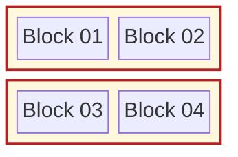

### Four blocks in a row

### Four blocks (wrapping - two columns)

### Four blocks (wrapping - one column)

### Four blocks (one group)

### Four blocks (two groups - no columns)

### Four blocks (two groups - one column)

